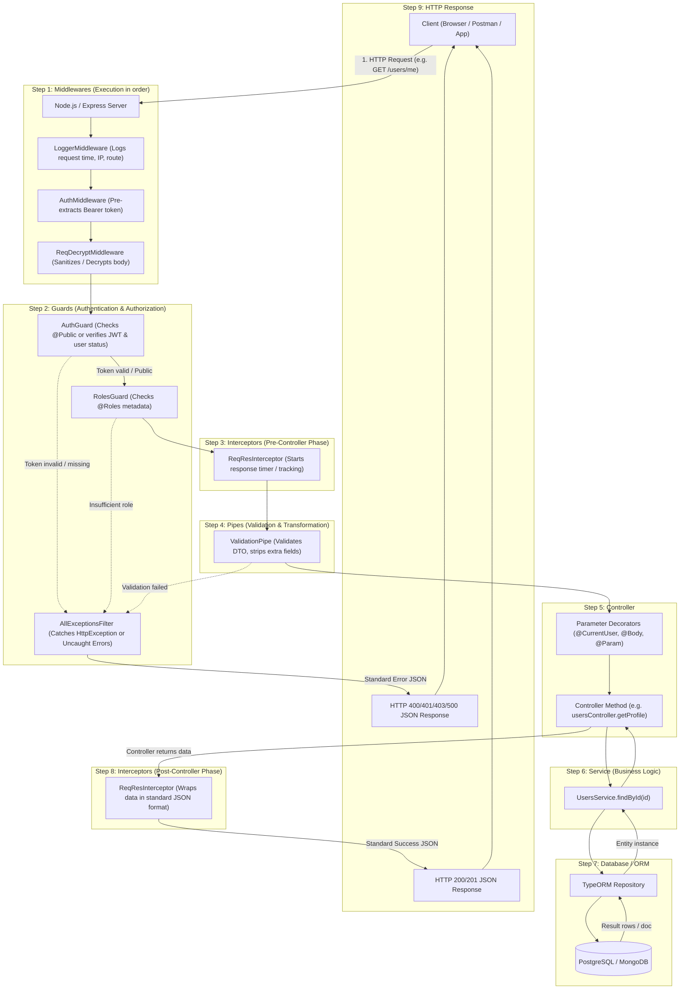
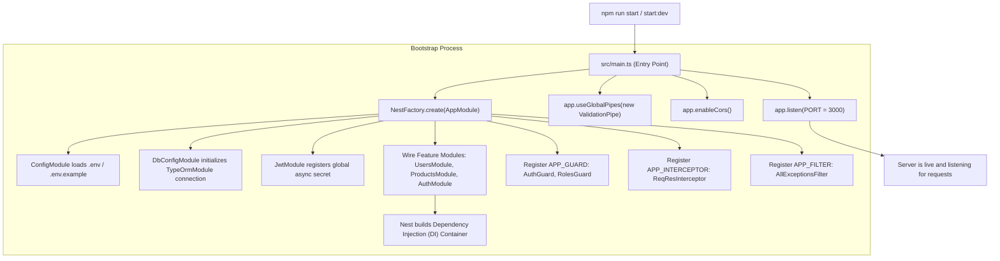
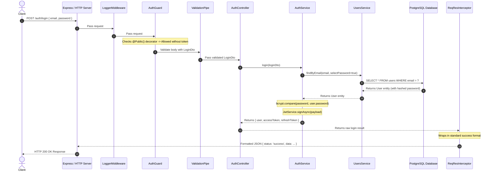
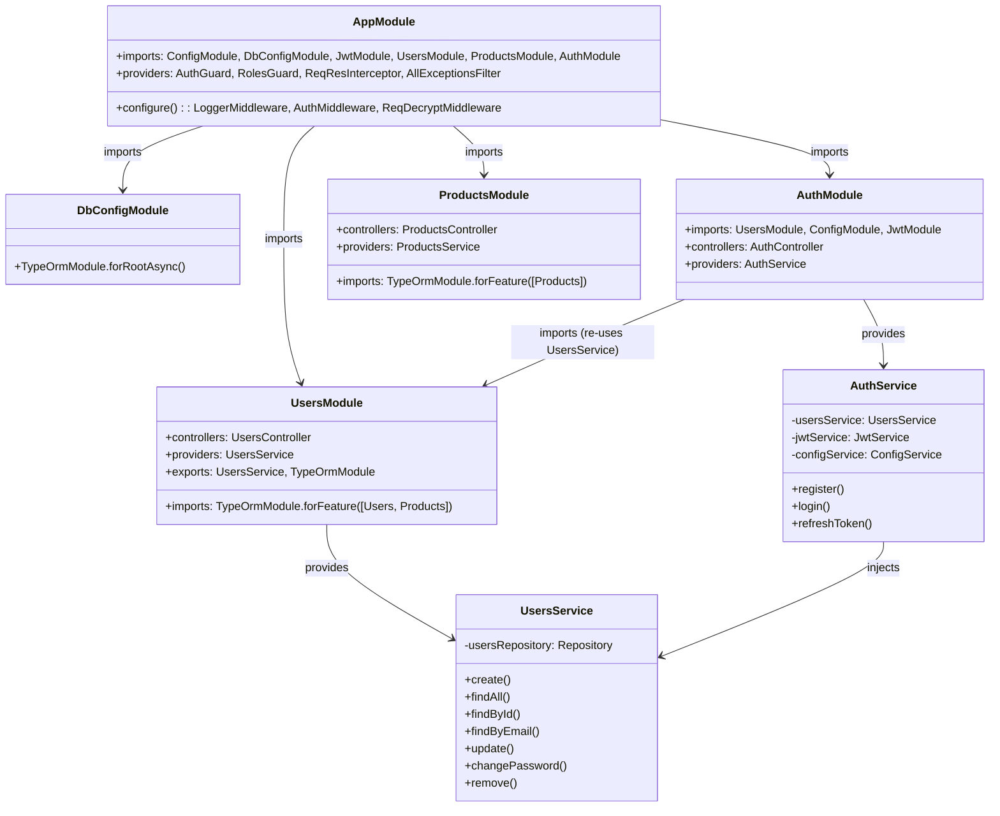

# NestJS Application Architecture, Startup & API Lifecycle Guide

This document explains exactly how this NestJS application starts, how files are interlinked through Dependency Injection (DI), and what happens step-by-step when an API call arrives at the server.

---

## 1. Visual Flow Diagrams

### Diagram A: End-to-End Request/Response Lifecycle (Control Shift)



---

### Diagram B: NestJS Application Startup & Bootstrapping Flow



---

## 2. How NestJS Starts (Detailed Bootstrapping Flow)

### Step 1: The Command Execution
When you run `npm run start:dev` or `npm run start`, the script in `package.json` executes:
`nest start --watch` (or `node dist/main.js` in production).
Nest looks at `nest-cli.json` and `tsconfig.json` to find `sourceRoot: "src"`.

### Step 2: The First File Executed — `src/main.ts`
`src/main.ts` is the foundational entry point of the entire application.
Here is what happens line-by-line:
1. `NestFactory.create(AppModule)` is called.
2. Nest reads `AppModule` (`src/app.module.ts`), which acts as the root module of the dependency tree.
3. Nest creates the Dependency Injection (DI) Container:
   - Evaluates `ConfigModule.forRoot(...)`: Reads environment variables from `.env` (or `.env.example`).
   - Evaluates `DbConfigModule` (`src/config/db.config.ts`): Instantiates TypeORM connection to PostgreSQL or MongoDB with the credentials from `ConfigService`.
   - Evaluates `JwtModule.registerAsync(...)`: Provides `JwtService` globally with `JWT_SECRET`.
   - Evaluates Feature Modules:
     - `UsersModule`: Registers `Users` and `Products` entities in TypeORM, instantiates `UsersService`, instantiates `UsersController`.
     - `AuthModule`: Imports `UsersModule`, instantiates `AuthService`, instantiates `AuthController`.
     - `ProductsModule`: Instantiates `ProductsService` and `ProductsController`.
4. Globally binds:
   - `AuthGuard` as `APP_GUARD`
   - `RolesGuard` as `APP_GUARD`
   - `ReqResInterceptor` as `APP_INTERCEPTOR`
   - `AllExceptionsFilter` as `APP_FILTER`
5. Configures middleware via `AppModule.configure(...)`:
   - Attaches `LoggerMiddleware`, `AuthMiddleware`, and `ReqDecryptMiddleware` to all routes `('*')`.
6. Sets up Global Pipes in `main.ts`:
   - `ValidationPipe`: Whitelists allowed DTO fields, throws errors on unauthorized parameters (`forbidNonWhitelisted: true`), and auto-transforms request strings to typed objects (`transform: true`).
7. Executes `await app.listen(port)`:
   - Starts the HTTP server on port 3000.
   - Logs: `Application is running on: http://localhost:3000`.

---

## 3. Step-by-Step API Request & Response Lifecycle

When a client sends an HTTP request (for example: `GET /users/me` with `Authorization: Bearer <token>`), the request flows through distinct layers in an exact, deterministic order.

```
Request ➡️ Middleware ➡️ Guards ➡️ Interceptors (Pre) ➡️ Pipes ➡️ Controller ➡️ Service ➡️ Database
                                                                                           ⬇️
Response ⬅️ Client ⬅️ Exception Filter (if error) ⬅️ Interceptors (Post) ⬅️ Controller ⬅️ Service
```

### 1. HTTP Server Layer (Express)
The underlying Express HTTP server receives the raw TCP packet, parses HTTP headers, path, method, query parameters, and body.

### 2. Middleware Layer
Middlewares execute in the exact order they are registered in `AppModule`:
1. **`LoggerMiddleware` (`src/common/middleware/logger.middleware.ts`)**:
   - Records incoming method, URL, client IP, user agent, and starts a high-resolution timer.
   - Listens to the `res.on('finish')` event to log total processing duration in milliseconds once the response completes.
2. **`AuthMiddleware` (`src/common/middleware/auth.middleware.ts`)**:
   - Looks for `Authorization: Bearer <token>` in the header.
   - If present, decodes it safely without blocking or throwing, attaching `req.tokenUser`.
3. **`ReqDecryptMiddleware` (`src/common/middleware/req-decrypt.middleware.ts`)**:
   - Inspects body for encrypted payloads and decrypts/sanitizes if needed.
   - Calls `next()` to pass control to the routing engine.

### 3. Guards Layer (Authentication & Authorization)
Guards determine whether a request should be allowed to reach the controller method.
1. **`AuthGuard` (`src/common/guards/auth.guard.ts`)**:
   - Checks if the target controller method or class has the `@Public()` decorator (using `Reflector`). If `@Public()`, it skips token validation and returns `true`.
   - Checks if route path is in `PUBLIC_ROUTES` (e.g. `/auth/login`, `/auth/register`). If matched, returns `true`.
   - If protected:
     - Extracts Bearer token from header. If absent, throws `UnauthorizedException('Authentication token is missing')`.
     - Verifies token signature and expiration with `jwtService.verifyAsync(...)`.
     - Queries the database for the active user via `usersRepository.findOne(...)`.
     - Verifies user exists and `isActive === true`.
     - Attaches the complete user record to `request.user` and `request.identity`.
2. **`RolesGuard` (`src/common/guards/roles.guard.ts`)**:
   - Reads `@Roles(...)` metadata using `Reflector`.
   - If no roles are required on the route, allows the request.
   - If roles are specified (e.g. `@Roles(UserRole.ADMIN)`), checks `request.user.role`. If matching, returns `true`; otherwise throws `ForbiddenException`.

### 4. Interceptors (Pre-Controller Phase)
- **`ReqResInterceptor` (`src/common/interceptors/reqRes.ts`)**:
  - Interceptors wrap the execution of the route handler.
  - In the pre-handler phase, it sets up an RxJS pipeline for intercepting the eventual return value from the controller.

### 5. Pipes Layer (Validation & Transformation)
- **`ValidationPipe` (`src/main.ts`)**:
  - Inspects the request payload against the parameter's DTO class (e.g., `CreateUserDto`, `LoginDto`, `QueryUserDto`).
  - Uses `class-validator` rules (`@IsEmail()`, `@IsNotEmpty()`, `@MinLength(6)`, etc.).
  - Strips unknown fields that are not in the DTO (`whitelist: true`).
  - If invalid data is sent, immediately throws `BadRequestException` with a formatted list of validation errors, bypassing the controller entirely.

### 6. Controller Layer (`src/modules/*/*.controller.ts`)
- Matches the route path (e.g., `@Controller('users')` + `@Get('me')` = `GET /users/me`).
- Parameter decorators execute:
  - `@CurrentUser()` extracts `req.user` directly.
  - `@Body()` extracts validated DTO.
  - `@Param('id', ParseIntPipe)` converts URL parameter string `"5"` to number `5`.
  - `@Query()` extracts query params into `QueryUserDto`.
- The controller delegates work to the corresponding service method:
  `this.usersService.findById(currentUser.id)`.

### 7. Service Layer (Business Logic)
- **`UsersService` / `AuthService`**:
  - Implements all business rules: checks if an email is already registered, hashes passwords using `bcrypt.hash(...)`, calculates pagination metadata, applies search queries, handles password resets, etc.
  - Contains no HTTP-specific concepts (like `res.send()`), making it reusable and unit-testable.

### 8. Database / Repository Layer (TypeORM)
- Uses `Repository<Users>` injected via `@InjectRepository(Users)`.
- Translates TypeScript repository methods (`findOne`, `save`, `createQueryBuilder`) into SQL queries.
- Executes queries against PostgreSQL (or MongoDB) and maps raw table rows back into rich TypeScript entity instances (`Users`).

### 9. Return to Service and Controller
- Database result is returned to the Service.
- Service processes data (e.g., removes the hashed password field) and returns plain data to the Controller.
- Controller method returns data to Nest's response pipeline.

### 10. Interceptors (Post-Controller Phase)
- The RxJS `map` operator in `ReqResInterceptor` intercepts the returned value.
- Formats the payload into a consistent JSON response:
  ```json
  {
    "statusCode": 200,
    "status": "success",
    "message": "Profile retrieved successfully",
    "data": {
      "id": 1,
      "firstName": "John",
      "lastName": "Doe",
      "email": "john@example.com",
      "role": "user",
      "isActive": true
    },
    "timestamp": "2026-11-26T17:30:00.000Z"
  }
  ```

### 11. Exception Filters (Error Handling)
- If **any** error is thrown anywhere in the pipeline (invalid password, duplicate email, database connection error, missing token, failed validation):
  - `AllExceptionsFilter` (`src/common/filters/http-exception.filter.ts`) catches it.
  - Extracts status code (`400`, `401`, `403`, `404`, `500`).
  - Formats a clean, predictable error response:
    ```json
    {
      "statusCode": 401,
      "status": "failed",
      "message": "Invalid email or password",
      "error": "Unauthorized",
      "path": "/auth/login",
      "timestamp": "2026-11-26T17:30:00.000Z"
    }
    ```

### 12. Final HTTP Response
Express transmits the finalized HTTP response with headers and body back across the network to the client.

---

## 4. Sequence Diagram: Authentication Flow (`POST /auth/login`)



---

## 5. How Files Are Interlinked (Dependency Injection Map)



### Complete Code Interlink Walkthrough

| File | Type | What It Does & How It Connects to Others |
| :--- | :--- | :--- |
| `src/main.ts` | **Application Entry Point** | Bootstraps `AppModule`, registers global `ValidationPipe`, enables CORS, and starts HTTP server on `PORT`. |
| `src/app.module.ts` | **Root Module** | Connects all modules together (`DbConfigModule`, `UsersModule`, `AuthModule`, `ProductsModule`). Binds global guards, interceptors, filters, and configures middlewares. |
| `src/config/db.config.ts` | **Database Config** | Configures TypeORM for PostgreSQL / MongoDB using values from `ConfigService`. |
| `src/common/guards/auth.guard.ts` | **Global Auth Guard** | Checks `@Public()` decorator or `PUBLIC_ROUTES`. Verifies JWT token, fetches active user from DB, and attaches to `req.user`. |
| `src/common/guards/roles.guard.ts` | **Global RBAC Guard** | Reads `@Roles(...)` metadata using `Reflector` and ensures `req.user.role` has the required permissions. |
| `src/common/decorators/*.ts` | **Custom Decorators** | `@Public()` bypasses auth; `@CurrentUser()` extracts user; `@Roles(...)` specifies required role. |
| `src/common/middleware/*.ts` | **Middlewares** | `LoggerMiddleware` logs HTTP requests; `AuthMiddleware` pre-extracts tokens; `ReqDecryptMiddleware` handles request payload decryption. |
| `src/common/interceptors/reqRes.ts` | **Interceptor** | Standardizes every successful HTTP response into `{ statusCode, status: 'success', message, data, timestamp }`. |
| `src/common/filters/http-exception.filter.ts` | **Global Filter** | Catches all exceptions application-wide and returns uniform `{ statusCode, status: 'failed', message, error, timestamp }`. |
| `src/modules/users/users.entity.ts` | **Database Model** | Defines `Users` table schema with TypeORM columns, relations (`addedBy`, `createdUsers`, `products`), and `password` hidden by default. |
| `src/modules/users/dto/` | **Data Transfer Objects** | Defines validation schemas for creating, updating, querying users, and changing passwords. |
| `src/modules/users/users.service.ts` | **Users Business Logic** | Manages user CRUD, bcrypt hashing, pagination, soft-deletes, and database interactions via `Repository<Users>`. |
| `src/modules/users/users.controller.ts` | **Users API Routes** | Exposes REST endpoints (`/users`, `/users/me`, `/users/:id`, etc.) and routes them to `UsersService`. |
| `src/modules/auth/auth.service.ts` | **Auth Business Logic** | Injects `UsersService` to find/create users, verifies passwords with `bcrypt`, and generates JWT access/refresh tokens. |
| `src/modules/auth/auth.controller.ts` | **Auth API Routes** | Exposes `@Public()` authentication endpoints (`/auth/login`, `/auth/register`, `/auth/refresh`, etc.). |

---

## 6. Quick Mental Model (Summary Cheat Sheet)

1. **Bootstrap**: `package.json` ➡️ `main.ts` ➡️ `NestFactory.create(AppModule)` ➡️ Wire DI & DB ➡️ Global Pipes & Middleware ➡️ `listen(3000)`.
2. **Inbound Request**: Express ➡️ `LoggerMiddleware` ➡️ `AuthMiddleware` ➡️ `ReqDecryptMiddleware` ➡️ `AuthGuard` (checks token) ➡️ `RolesGuard` ➡️ `ReqResInterceptor` (pre) ➡️ `ValidationPipe` (validates DTO) ➡️ `Controller` ➡️ `Service` ➡️ `TypeORM Repository` ➡️ Database.
3. **Outbound Response**: Database ➡️ `Service` ➡️ `Controller` ➡️ `ReqResInterceptor` (post: wraps in `{ status, data }`) ➡️ Express ➡️ Client.
4. **On Error**: Any layer throwing an exception ➡️ Caught by `AllExceptionsFilter` ➡️ Formatted as `{ status: 'failed', message, error }` ➡️ Client.
